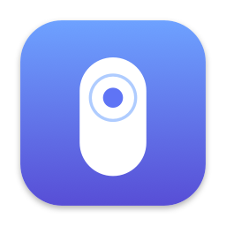
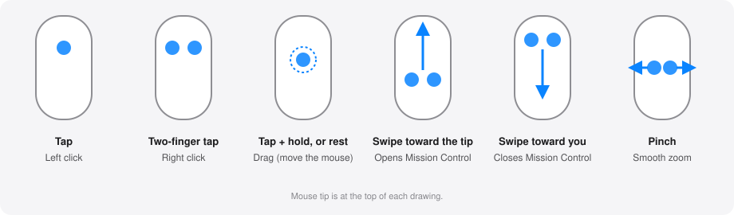

<p align="center"></p>

# MagicTap

**Tocar para hacer clic en el Magic Mouse de Apple, en macOS.**

macOS solo ofrece *Tocar para hacer clic* en trackpads. MagicTap es una pequeña
app de barra de menús, de código abierto, que lo añade al Magic Mouse:



| Gesto | Acción |
|---|---|
| Toque con un dedo | Clic izquierdo |
| Toque con dos dedos | Clic derecho |
| Mantener tres dedos 0,5 s | Mostrar escritorio por defecto; configurable (clic central, Mission Control o nada) |
| Dos toques seguidos (en menos de 0,5 s, con el ratón quieto) | Doble clic (abrir archivos y carpetas, seleccionar una palabra) |
| Apoyar un dedo quieto ~0,25 s (sin mover el ratón) | El mismo arrastre, sin toque previo |
| Deslizar 2 dedos hacia la punta / hacia ti | Abre / cierra Mission Control |
| Deslizar 1 dedo a izquierda / derecha | Atrás / adelante en el navegador: Chrome muestra su flecha y vuelve si sigues el gesto, cancela si paras (gesto de scroll como el del trackpad) |
| Pellizco con 2 dedos (separar / juntar) | Zoom fluido, como el trackpad (gesto de ampliación, no atajos de teclado) |
| Toque, y volver a tocar y mantener quieto | Mantiene el botón pulsado; mueve el ratón para arrastrar (seleccionar texto, mover ventanas); levanta el dedo para soltar |

Los clics físicos siguen funcionando igual. Sin icono en el Dock, sin ventanas,
sin telemetría y sin acceso a la red.

[Read in English](README.md)

> **Estado: prototipo inicial (v0.1).** La lógica de reconocimiento tiene tests
> unitarios, pero los umbrales están ajustados "a ojo" y la capa multitáctil usa
> una API privada de Apple. Mira [Limitaciones](#limitaciones).

## Requisitos

- macOS 13 o superior (desarrollado en macOS 27)
- Xcode o el toolchain de Swift (para compilar desde el código)
- Un Apple Magic Mouse (Lightning o USB-C)

## Descarga

Descarga `MagicTap-0.2.0.dmg` desde la
[última release](https://github.com/Cosmichomeless/magictap/releases/latest),
ábrelo y arrastra **MagicTap** a **Aplicaciones**.

La app está firmada ad-hoc y **sin notarizar** (hace falta una cuenta de pago de
Apple Developer), así que macOS bloquea el primer arranque. Para abrirla igualmente:
clic derecho sobre la app → **Abrir** → **Abrir**, o ejecuta
`xattr -dr com.apple.quarantine /Applications/MagicTap.app`. Después concede el
permiso de Accesibilidad (abajo).

## Compilar e instalar

```sh
git clone https://github.com/Cosmichomeless/magictap.git
cd magictap
scripts/build-app.sh --install     # compila, firma ad-hoc y copia a ~/Applications
open ~/Applications/MagicTap.app
```

La primera vez, macOS pide permiso de **Accesibilidad** (hace falta para generar
los clics). Actívalo en
*Ajustes del Sistema → Privacidad y seguridad → Accesibilidad*.

Sin `--install`, el script solo genera `build/MagicTap.app`.

## Uso

Pulsa el icono del ratón en la barra de menús y elige **Settings…** (⌘,) para abrir la ventana:

- **Gestures** — todos los interruptores y sliders de velocidad del toque, ventana del doble toque, tiempo para arrastrar, longitud del deslizamiento, velocidad del zoom y margen de agarre, con *Restore defaults*.
- **Live** — un Magic Mouse dibujado con tus dedos encima (naranja = agarre, se ignora) y los gestos según se detectan. Útil para ajustar los sliders.
- **Setup** — permiso de Accesibilidad y estado del ratón en vivo, más *Launch at login*. Se abre sola si falta el permiso.

El menú tiene los mismos interruptores:

- **Enabled** — interruptor general.
- **Tap → left click** / **Two-finger tap → right click** / **Double tap → double click** / **Tap, then hold → drag** / **Rest finger → drag** / / **Two-finger swipe up/down → Mission Control** / **Two-finger pinch → zoom** — activa o desactiva cada gesto.
- **One-finger swipe left/right → back/forward** — activa o desactiva el gesto atrás/adelante.
- **Three-finger hold** — apoya tres dedos medio segundo; elige qué hace: Show Desktop (por defecto), clic central, Mission Control o nada.
- **Launch at login** — solo funciona desde la `.app` empaquetada.

### Probar sin hacer clics

```sh
swift run MagicTap --debug
```

`--debug` imprime cada fotograma táctil y cada toque reconocido, y **nunca
genera clics**. Sirve para comprobar que tu ratón se detecta y ver cómo son tus toques.

### Doble toque

Dos toques rápidos (el segundo en menos de 0,5 s del primero, con el ratón casi
quieto) envían un doble clic real: el segundo clic lleva contador 2, así que
Finder abre el elemento y los campos de texto seleccionan una palabra. Un tercer
toque empieza una pareja nueva. Si en vez de levantar el dedo lo mantienes, es un
arrastre (ver abajo).

### Tocar y arrastrar

Como el "tocar para arrastrar" del trackpad: toca una vez y, antes de 0,6 s,
vuelve a tocar y mantén ese dedo quieto. Tras unos 0,2 s el botón se pulsa donde
empezó el toque. Mueve el ratón como siempre para arrastrar y levanta el dedo para
soltar. Si deslizas el dedo es un scroll normal y no empieza un arrastre.

También puedes saltarte el toque: apoya un dedo sin moverlo (ni el ratón) unos
0,25 s y el botón se pulsa. Tiene que ser menos que el filtro de agarre (0,3 s).

## Cómo se reconoce un toque

Un contacto cuenta como toque solo si se cumple **todo** esto:

1. Dura entre 20 ms y 200 ms.
2. Los dedos casi no se mueven (no es un scroll ni un deslizamiento).
3. El cursor no se mueve más de 4 puntos (no estás simplemente moviendo el ratón).
4. No hay una pulsación física del botón mientras tanto.
5. Se usó exactamente un dedo (clic izquierdo) o dos (clic derecho); con tres dedos hay que mantenerlos 0,5 s (acción de tres dedos).

Estos valores están en [`TapConfig`](Sources/MagicTapCore/TapDetector.swift).
La arquitectura, la API privada y la resolución de problemas están en
[docs/how-it-works.md](docs/how-it-works.md).

## Desarrollo

```sh
swift build      # compilar
swift test       # tests unitarios del reconocimiento de toques
```

## Limitaciones

- **API privada.** Los datos táctiles salen del framework no documentado
  `MultitouchSupport`. Una actualización de macOS puede romperlo y la app no
  puede publicarse en la Mac App Store. Los símbolos se resuelven en ejecución,
  así que si falta alguno aparece un error en vez de un cierre inesperado.
- **Toques accidentales.** La superficie del Magic Mouse es grande y la mano
  descansa sobre ella. Las comprobaciones de duración, movimiento y recorrido
  del cursor reducen los falsos clics, pero no los eliminan.
- **Permiso tras recompilar.** Con la firma ad-hoc por defecto, macOS vuelve a
  pedir Accesibilidad tras cada compilación. Usa `SIGN_IDENTITY` con un
  certificado estable para evitarlo.
- **Solo Magic Mouse.** Los trackpads se ignoran a propósito: ya tienen
  tocar-para-hacer-clic nativo.

## Licencia

[MIT](LICENSE). Proyecto independiente, sin relación con Apple ni respaldado por
ella. *Magic Mouse* es una marca registrada de Apple Inc.
