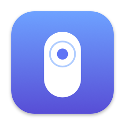
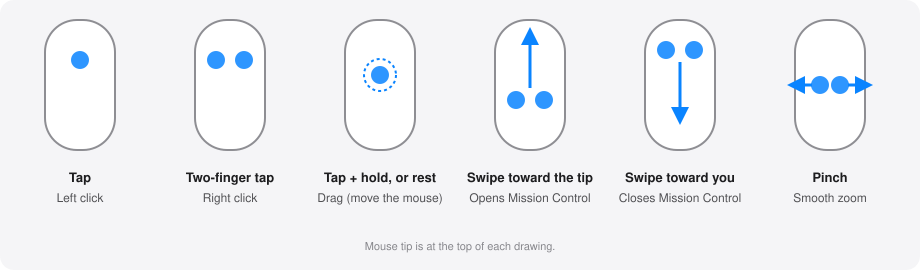

<p align="center"></p>

# MagicTap

**Tap-to-click for the Apple Magic Mouse on macOS.**

macOS only offers *Tap to click* for trackpads. MagicTap is a tiny open-source
menu bar app that adds it to the Magic Mouse:



| Gesture | Action |
|---|---|
| Tap with one finger | Left click |
| Tap with two fingers | Right click |
| Tap twice quickly (within 0.5 s, mouse still) | Double click (open files and folders, select a word) |
| Rest one finger still for ~0.25 s (mouse not moving) | Same drag, without a prior tap |
| Swipe two fingers toward the tip / toward you | Opens / closes Mission Control |
| Pinch two fingers apart / together | Smooth zoom in / out, like the trackpad (a magnify gesture, not keyboard shortcuts) |
| Tap, then touch again and hold still | Press and hold the button; move the mouse to drag (select text, move windows); lift the finger to release |

Physical clicks keep working exactly as before. No Dock icon, no windows, no
telemetry, no network access.

[Leer en español](README.es.md)

> **Status: early prototype (v0.1).** The recognition logic is unit-tested, but
> thresholds are tuned by feel and the multitouch layer relies on a private
> Apple API. See [Limitations](#limitations).

## Requirements

- macOS 13 or later (developed on macOS 27)
- Xcode or the Swift toolchain (to build from source)
- An Apple Magic Mouse (Lightning or USB-C)

## Build and install

```sh
git clone https://github.com/Cosmichomeless/magictap.git
cd magictap
scripts/build-app.sh --install     # builds, signs ad-hoc, copies to ~/Applications
open ~/Applications/MagicTap.app
```

On first launch macOS asks for **Accessibility** permission (needed to post
the synthetic clicks). Enable MagicTap in
*System Settings → Privacy & Security → Accessibility*.

Use `scripts/build-app.sh` without `--install` to only build `build/MagicTap.app`.

## Usage

Click the mouse icon in the menu bar:

- **Enabled** — master switch.
- **Tap → left click** / **Two-finger tap → right click** — toggle each gesture.
- **Double tap → double click** — toggle the double click.
- **Tap, then hold → drag** — toggle tap-and-drag.
- **Rest finger → drag** — toggle the drag that needs no prior tap.
- **Two-finger swipe up/down → Mission Control** / **Two-finger pinch → zoom** — toggle each gesture. Turn off the matching Magic Mouse options in System Settings so they don't fire twice.
- **Launch at login** — only works from the bundled `.app`.

### Try it without clicking anything

```sh
swift run MagicTap --debug
```

`--debug` prints every touch frame and each recognized tap, and **never injects
clicks**. Use it to confirm your mouse is detected and to see how your taps look.

### Double tap

Two quick taps (the second within 0.5 s of the first, with the mouse nearly
still) send a real double click: the second click carries click count 2, so
Finder opens the item and text views select a word. A third tap starts a new
pair. If you touch again and hold instead of lifting, it is a drag (see below).

### Tap and drag

Like "tap to drag" on a trackpad: tap once, then within 0.6 s touch again and
keep that finger still. After about 0.2 s the button goes down where the touch
began. Now move the mouse as usual to drag, and lift your finger to drop. Sliding
the finger instead is a normal scroll and does not start a drag.

You can also skip the tap: rest one finger without moving it or the mouse for
about a quarter of a second and the button goes down. (It has to stay under the
0.3 s grip filter, hence the short delay.)

## How a tap is recognized

A touch counts as a tap only if **all** of these hold:

1. The contact lasts between 20 ms and 200 ms.
2. The fingers barely move (it is not a scroll or swipe).
3. The cursor does not move more than 4 points (you are not just moving the mouse).
4. No physical button press happens meanwhile.
5. Exactly one finger (left click) or two fingers (right click) were used.

These defaults live in [`TapConfig`](Sources/MagicTapCore/TapDetector.swift).
See [docs/how-it-works.md](docs/how-it-works.md) for the architecture, the
private API details and troubleshooting.

## Development

```sh
swift build      # build
swift test       # run the tap-recognition unit tests
```

```
Sources/
  MagicTapCore/   pure tap-recognition logic (no hardware, unit-tested)
  MagicTap/       menu bar app: multitouch input, click injection, UI
Tests/            unit tests for MagicTapCore
scripts/          build-app.sh, make-icon.swift (regenerates the app icon)
Resources/        Info.plist, AppIcon.icns
docs/             how-it-works.md
```

## Limitations

- **Private API.** Touch data comes from Apple's undocumented
  `MultitouchSupport` framework. A macOS update can break it, and the app
  cannot be distributed on the Mac App Store. Symbols are resolved at runtime,
  so a missing API produces an error message instead of a crash.
- **Accidental taps.** The Magic Mouse surface is large and your hand rests on
  it. The duration, movement and cursor-travel checks reduce false clicks but
  cannot eliminate them.
- **Permission after rebuilds.** With the default ad-hoc signature macOS asks
  for Accessibility again after each build. Set `SIGN_IDENTITY` to a stable
  certificate to avoid it.
- **Magic Mouse only.** Trackpads are intentionally ignored; they already have
  native tap-to-click.

## License

[MIT](LICENSE). This project is independent and not affiliated with or endorsed
by Apple. *Magic Mouse* is a trademark of Apple Inc.
